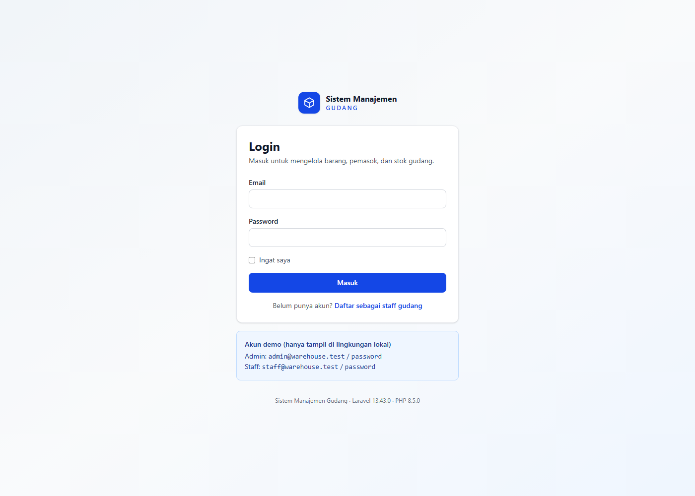
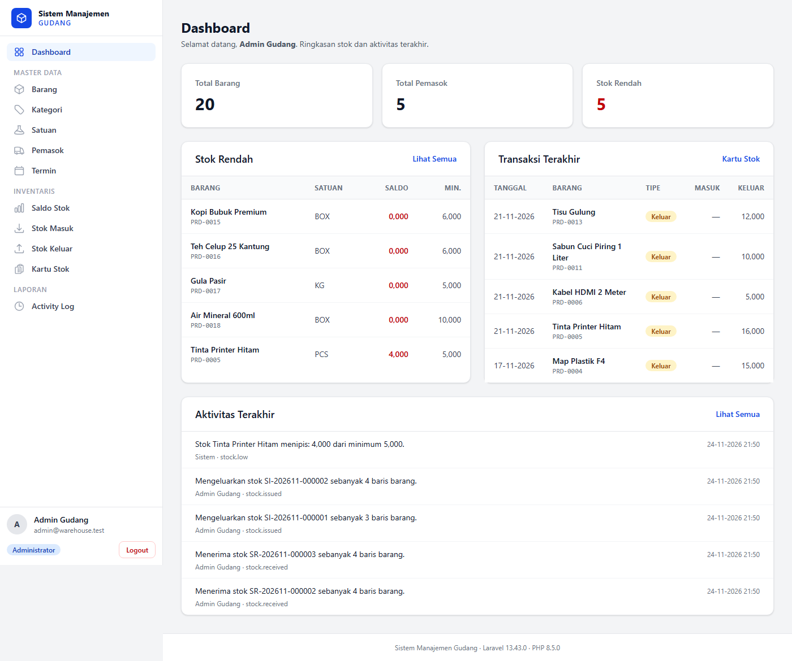
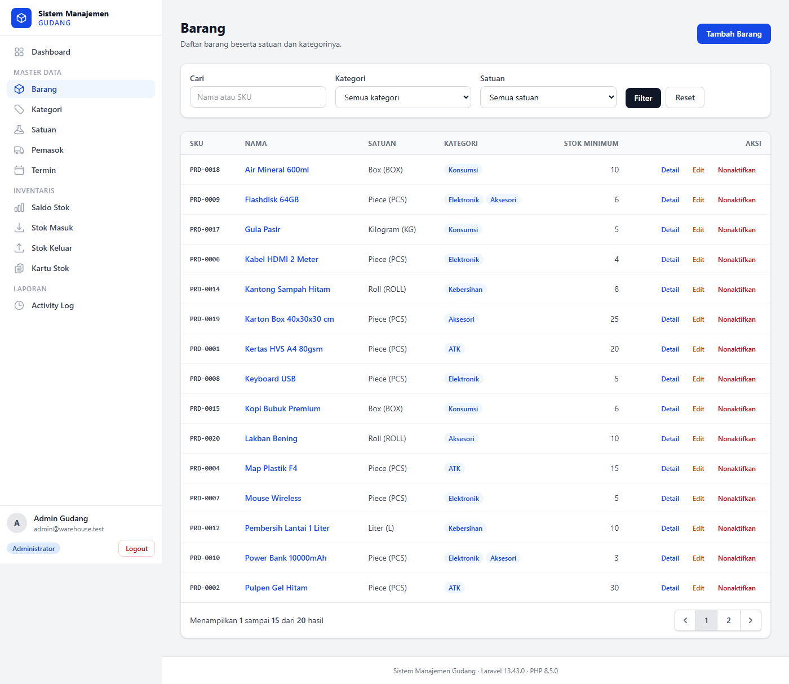
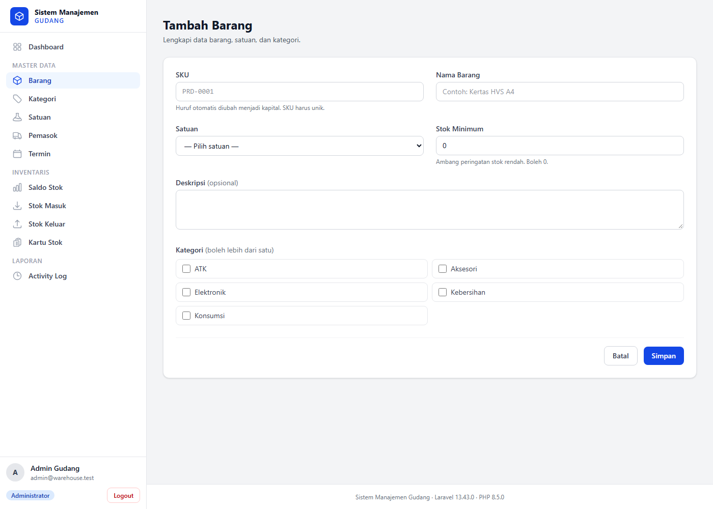
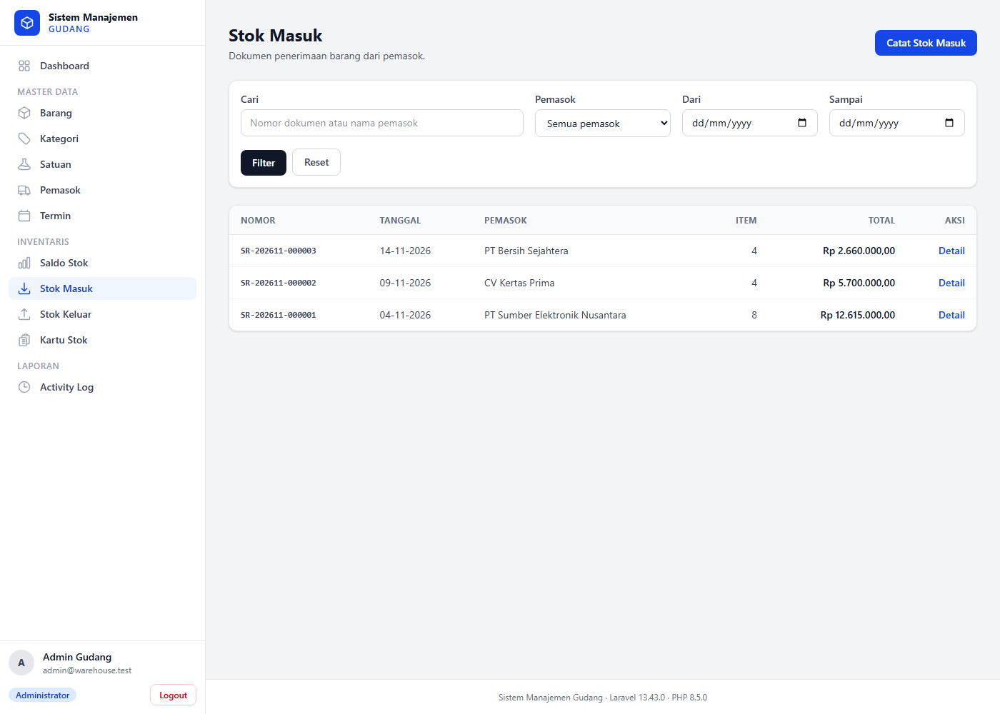
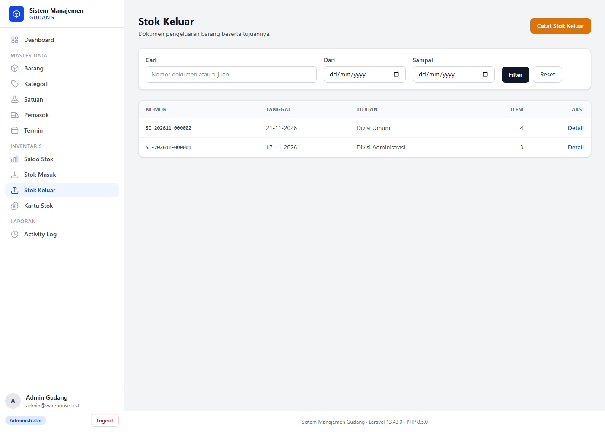
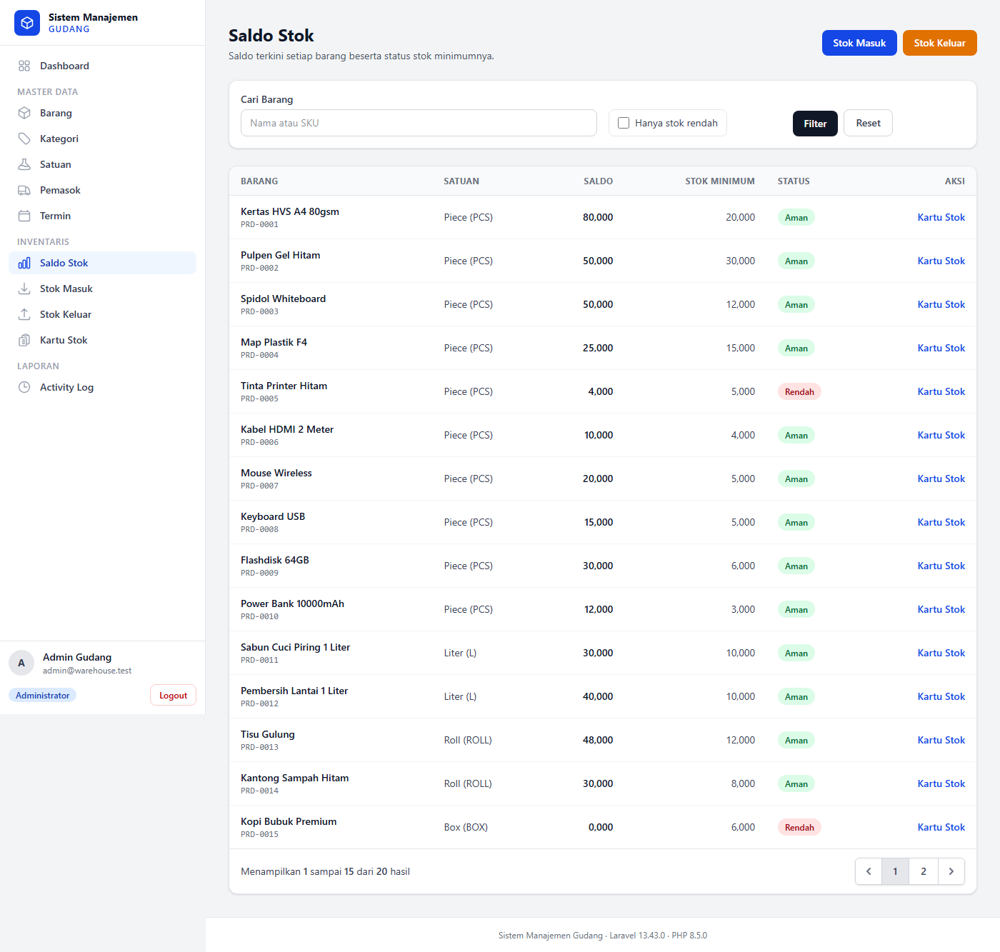
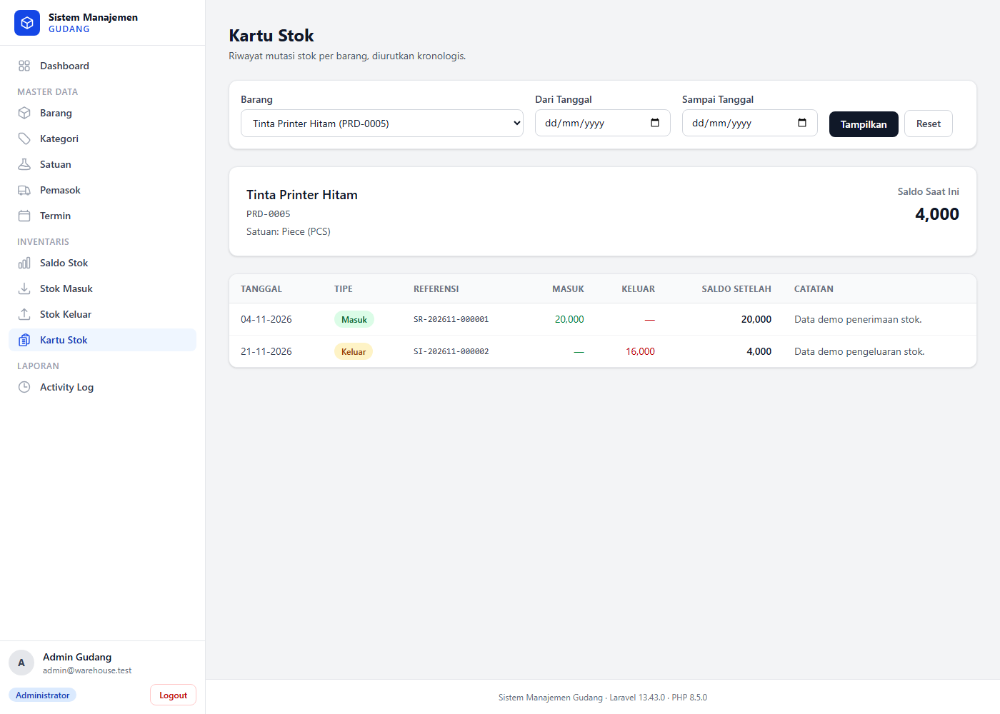

# Sistem Manajemen Gudang

Aplikasi **warehouse management system (WMS)** berbasis **Laravel 13** dengan arsitektur **modular monolith**. Proyek ini dibuat untuk studi kasus *Sistem Manajemen Gudang* pada mata kuliah Backend Development.

Aplikasi mencakup master data barang, kategori, satuan, pemasok, termin pembayaran, transaksi stok masuk/keluar, saldo stok, kartu stok, dashboard, activity log, serta pembatasan akses **Admin** dan **Staff Gudang**.


---

## Daftar Isi

- [Fitur Utama](#fitur-utama)
- [Tangkapan Layar](#tangkapan-layar)
- [Arsitektur](#arsitektur)
- [Kebutuhan Sistem](#kebutuhan-sistem)
- [Instalasi Cepat](#instalasi-cepat)
- [Akun Demo](#akun-demo)
- [Menjalankan Aplikasi](#menjalankan-aplikasi)
- [Pengujian](#pengujian)
- [Hak Akses (RBAC)](#hak-akses-rbac)
- [API](#api)
- [Struktur Proyek](#struktur-proyek)
- [Dokumentasi](#dokumentasi)
- [Batasan](#batasan)

---

## Fitur Utama

### Master Data

- CRUD **Barang** dengan SKU unik, satuan, banyak kategori, stok minimum, dan soft delete.
- CRUD **Kategori** dan **Satuan** dengan pengamanan penghapusan jika masih dipakai.
- CRUD **Pemasok** dengan kontak, termin pembayaran, dan soft delete.
- CRUD **Termin Pembayaran** dengan pengamanan penghapusan jika masih dipakai.

### Inventaris

- **Stok Masuk** multi-item per dokumen, lengkap dengan harga satuan dan total.
- **Stok Keluar** multi-item dengan validasi saldo di dalam transaksi database.
- **Saldo Stok** seluruh barang beserta status aman/rendah.
- **Kartu Stok** (ledger mutasi) per barang dengan filter rentang tanggal dan saldo setelah mutasi.
- Nomor dokumen otomatis: `SR-YYYYMM-000001` dan `SI-YYYYMM-000001`.
- Stok tidak pernah negatif; seluruh dokumen di-*rollback* jika satu item gagal.

### Operasional

- Login/register dengan session guard dan **Laravel Sanctum** untuk API.
- **RBAC** dua peran: `admin` dan `staff_gudang`.
- **Dashboard** berisi total barang, total pemasok, stok rendah, transaksi terakhir, dan aktivitas terakhir.
- **Activity Log** admin-only dengan filter event, tanggal, dan aktor.
- Halaman error 403/404/419/429/500 yang ramah pengguna.
- UI responsif (sidebar desktop, menu *off-canvas* di perangkat kecil) dengan Tailwind CSS.

### Kualitas

- 137 test otomatis (750 assertions) — feature, unit, rollback, RBAC, API.
- Semua input divalidasi melalui **Form Request** dengan pesan berbahasa Indonesia.
- Tiga custom exception: `InsufficientStockException`, `ProductUnavailableException`, `SupplierUnavailableException`.
- Komunikasi antar modul melalui **contract** dan **domain event**, tanpa akses model lintas modul.
- Kode diformat dengan **Laravel Pint**.

---

## Tangkapan Layar

| Login | Dashboard |
|---|---|
|  |  |

| Barang | Form Barang |
|---|---|
|  |  |

| Stok Masuk | Stok Keluar |
|---|---|
|  |  |

| Saldo Stok | Kartu Stok |
|---|---|
|  |  |

> Daftar bukti tangkapan layar lengkap ada di [`dokumentasi/screenshots/README.md`](dokumentasi/screenshots/README.md).

---

## Arsitektur

Proyek menerapkan **modular monolith**: satu aplikasi Laravel, tetapi dipisahkan menjadi lima modul dengan batas tanggung jawab yang jelas.

```text
app/Modules/
├── Auth/        # user, role, login/register, Sanctum, RBAC
├── Product/     # barang, kategori, satuan
├── Supplier/    # pemasok, termin pembayaran
├── Inventory/   # stok masuk/keluar, saldo, kartu stok
└── Reporting/   # dashboard, activity log
```

Setiap modul memiliki `ServiceProvider`, `routes/`, `Database/Migrations`, `Models`, `Services`, `Http/Controllers`, `Http/Requests`, `Policies`, `resources/views`, serta `Contracts`/`DTO`/`Events` bila diperlukan.

**Aturan batas modul:**

- Modul lain tidak boleh mengakses model/tabel modul lain secara langsung.
- Query lintas modul dilakukan melalui *contract* yang mengembalikan *DTO*.
- Reaksi lintas modul dilakukan melalui *domain event* yang di-*dispatch* setelah commit.
- Arah dependensi: `Inventory → Product/Supplier/Auth` melalui contract; tidak ada dependensi melingkar.

Detail lengkap: [`dokumentasi/ARCHITECTURE.md`](dokumentasi/ARCHITECTURE.md) dan [`dokumentasi/CONTRACTS.md`](dokumentasi/CONTRACTS.md).

---

## Kebutuhan Sistem

| Komponen | Versi minimum |
|---|---|
| PHP | 8.3 (disarankan 8.4/8.5) |
| Composer | 2.x |
| Node.js | 20.x (disarankan 22/24) |
| NPM | 10.x |
| Database | SQLite (default) / MySQL 8 |

Ekstensi PHP yang dibutuhkan: `pdo_sqlite` (default), `mbstring`, `openssl`, `tokenizer`, `xml`, `ctype`, `json`, `bcmath`, `fileinfo`.

---

## Instalasi Cepat

```bash
# 1. Masuk ke folder proyek
cd sistem-manajemen-gudang-main

# 2. Jalankan skrip setup (install dependency, .env, key, migrasi + seeder, build asset)
composer setup

# 3. Jalankan server
php artisan serve
```

Buka <http://127.0.0.1:8000>.

### Instalasi Manual

```bash
composer install
cp .env.example .env          # Windows: copy .env.example .env
php artisan key:generate

# Pastikan file database SQLite tersedia
# Windows: type nul > database/database.sqlite
# Linux/macOS: touch database/database.sqlite

php artisan migrate:fresh --seed
npm install
npm run build
php artisan serve
```

### Menggunakan MySQL (opsional)

Ubah `.env`:

```dotenv
DB_CONNECTION=mysql
DB_HOST=127.0.0.1
DB_PORT=3306
DB_DATABASE=sistem_manajemen_gudang
DB_USERNAME=root
DB_PASSWORD=
```

Lalu jalankan `php artisan migrate:fresh --seed`.

---

## Akun Demo

Data demo dibuat oleh `php artisan migrate --seed`.

| Peran | Email | Password | Akses |
|---|---|---|---|
| Admin | `admin@warehouse.test` | `password` | Semua fitur, termasuk activity log |
| Staff Gudang | `staff@warehouse.test` | `password` | Baca master data, transaksi stok |
| Staff Gudang 2 | `staff2@warehouse.test` | `password` | Sama seperti staff |

> Password demo hanya untuk pengembangan lokal. Ganti sebelum deploy ke publik.

---

## Menjalankan Aplikasi

```bash
# Server pengembangan
php artisan serve

# Mode pengembangan frontend (opsional, saat mengubah tampilan)
npm run dev

# Build aset produksi
npm run build
```

Halaman utama akan mengarahkan ke login. Setelah masuk, pengguna diarahkan ke dashboard.

---

## Pengujian

```bash
# Seluruh test (SQLite in-memory)
php artisan test

# Test tertentu
php artisan test --filter=IssueStockTest

# Format kode
vendor/bin/pint --test
vendor/bin/pint        # perbaiki otomatis
```

Hasil terakhir:

```text
Tests:    137 passed (750 assertions)
Pint:     clean
```

Cakupan test mencakup autentikasi, RBAC, CRUD master data, transaksi stok, validasi stok, rollback, kartu stok, dashboard, activity log, dan API.

---

## Hak Akses (RBAC)

| Fitur | Admin | Staff Gudang |
|---|:---:|:---:|
| Dashboard | ✅ | ✅ |
| Lihat barang/kategori/satuan/pemasok/termin | ✅ | ✅ |
| Tambah/ubah/nonaktifkan master data | ✅ | ❌ (403) |
| Lihat saldo & kartu stok | ✅ | ✅ |
| Catat stok masuk/keluar | ✅ | ✅ |
| Activity Log | ✅ | ❌ (403) |
| API transaksi stok | ✅ | ✅ |

Implementasi: middleware `role`, `Gate::policy`, dan directive Blade `@role`. Detail: [`dokumentasi/RBAC.md`](dokumentasi/RBAC.md).

---

## API

Autentikasi menggunakan **Bearer token** (Sanctum).

| Method | Endpoint | Keterangan |
|---|---|---|
| `POST` | `/api/v1/auth/login` | Login, mengembalikan token |
| `POST` | `/api/v1/auth/logout` | Revoke token aktif |
| `GET` | `/api/v1/me` | Profil pengguna |
| `GET` | `/api/v1/inventory/balances` | Daftar saldo stok |
| `GET` | `/api/v1/inventory/products/{id}/movements` | Mutasi/kartu stok |
| `POST` | `/api/v1/inventory/receipts` | Buat stok masuk |
| `POST` | `/api/v1/inventory/issues` | Buat stok keluar |

Contoh:

```bash
curl -X POST http://127.0.0.1:8000/api/v1/auth/login \
  -H "Content-Type: application/json" \
  -d '{"email":"admin@warehouse.test","password":"password"}'
```

Error stok kurang mengembalikan **409** dengan `code: INSUFFICIENT_STOCK` dan `meta.available`/`meta.requested`.

---

## Struktur Proyek

```text
.
├── app/
│   ├── Modules/               # 5 modul domain
│   └── Providers/
├── bootstrap/
│   └── providers.php          # registrasi 5 module provider
├── database/
│   ├── migrations/            # migration global (cache, jobs)
│   ├── seeders/               # DatabaseSeeder
│   └── database.sqlite
├── dokumentasi/               # arsitektur, ERD, RBAC, testing, laporan
├── lang/id/                   # pesan validasi & pagination Indonesia
├── public/build/              # hasil build Vite
├── resources/
│   ├── css/app.css
│   ├── js/app.js
│   └── views/                 # layout, komponen, halaman error
├── routes/
├── tests/
│   ├── Feature/
│   └── Unit/
└── ...
```

---

## Dokumentasi

| Dokumen | Isi |
|---|---|
| [`dokumentasi/README.md`](dokumentasi/README.md) | Peta dokumentasi |
| [`dokumentasi/SETUP.md`](dokumentasi/SETUP.md) | Instalasi & troubleshooting |
| [`dokumentasi/ARCHITECTURE.md`](dokumentasi/ARCHITECTURE.md) | Bounded context, aturan modul, ADR |
| [`dokumentasi/DATABASE.md`](dokumentasi/DATABASE.md) | ERD, kamus data, relasi |
| [`dokumentasi/MODULES.md`](dokumentasi/MODULES.md) | Detail tiap modul & route |
| [`dokumentasi/CONTRACTS.md`](dokumentasi/CONTRACTS.md) | Contract, DTO, event |
| [`dokumentasi/RBAC.md`](dokumentasi/RBAC.md) | Matriks hak akses |
| [`dokumentasi/ERROR-HANDLING.md`](dokumentasi/ERROR-HANDLING.md) | Validasi & format error |
| [`dokumentasi/TESTING.md`](dokumentasi/TESTING.md) | Strategi & matriks pengujian |
| [`dokumentasi/LAPORAN.md`](dokumentasi/LAPORAN.md) | Kerangka laporan & video demo |
| [`dokumentasi/CHECKLIST.md`](dokumentasi/CHECKLIST.md) | Checklist kesiapan submit |

---

## Batasan

- Satu gudang (belum multi-warehouse).
- Belum ada modul pembelian/penjualan, barcode, dan laporan keuangan.
- `lockForUpdate()` efektif di MySQL/PostgreSQL; SQLite mengunci pada level database.
- Listener event berjalan sinkron (tanpa queue worker).
- Dokumen stok bersifat permanen dan tidak dapat diubah/dihapus.

---

## Lisensi

Proyek ini dibuat untuk keperluan akademik. Silakan gunakan sebagai referensi pembelajaran dengan mencantumkan sumber.

---

## Tim Pengembang

| Anggota | NIM | GitHub | Tanggung jawab utama |
|---|---|---|---|
| Fadhlan Nuha Mukhlishin | 25.01.5292 | [@fadhlannuha](https://github.com/fadhlannuha) | M0 Fondasi Laravel 13 & Sanctum, M1 Auth & RBAC, implementasi awal modul inti, M4 Inventory (transaksi, lock, rollback), UI/layout, integrasi & review PR |
| Najib Arafi | 25.01.5296 | [@najibarafi](https://github.com/najibarafi) | Audit & perbaikan M2 Product, M3 Supplier, M5 Reporting sesuai dokumentasi (index `deleted_at`, cakupan `search`, `dontReport` exception, seeder restore, info delete guard), test regresi, dokumentasi tim & bukti (M6–M7) |

Riwayat kontribusi riil tercermin pada `git log --format="%an <%ae> %s"` dan Pull Request di repositori.
