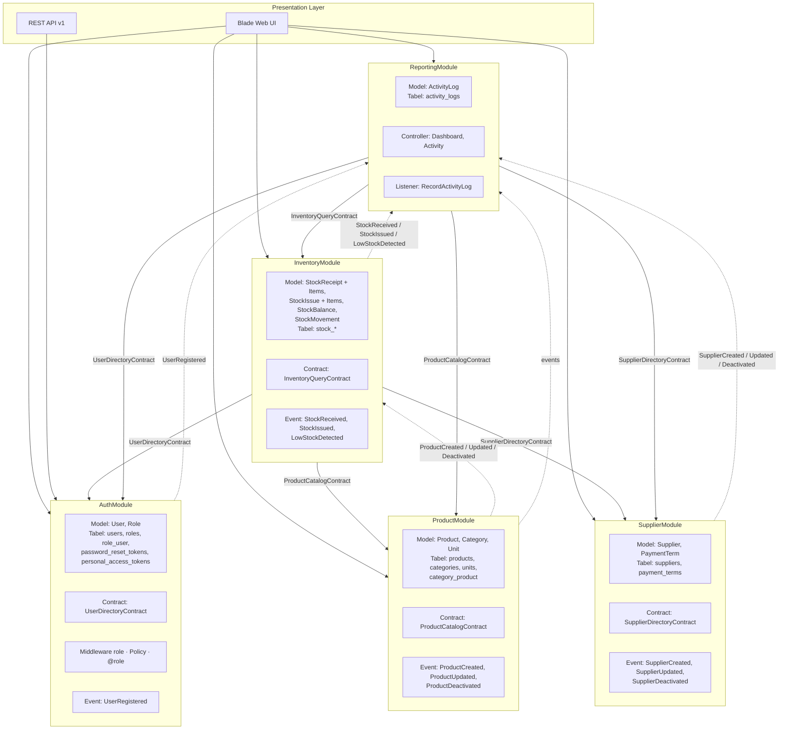
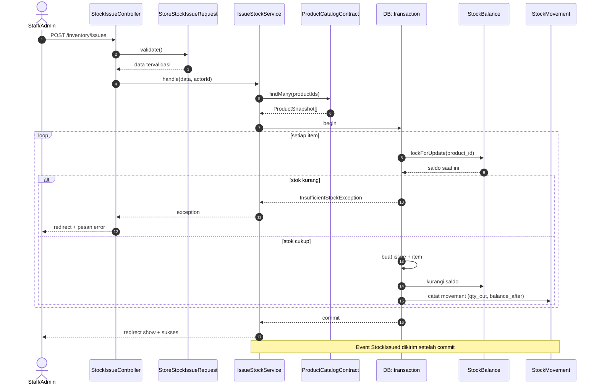

# Arsitektur — Sistem Manajemen Gudang

Dokumen ini mengunci struktur modular monolith, batas modul, mekanisme komunikasi, dan keputusan arsitektur. Implementasi harus mengikuti dokumen ini; perubahan keputusan harus dicatat sebagai ADR baru di bagian akhir.

## 1. Tujuan Arsitektur

1. Memenuhi ketentuan **Modular Monolith**: minimal 3 modul terpisah, masing-masing punya Service Provider, migration dan route sendiri.
2. Menegakkan **batas modul**: tidak ada modul yang mengakses model/tabel modul lain secara langsung.
3. Menyediakan **komunikasi eksplisit** melalui Contract (query sinkron) dan Domain Event (reaksi/efek samping).
4. Menjaga **integritas stok** melalui transaksi database, penguncian baris saldo, dan validasi ulang di dalam transaksi.
5. Menjaga **keamanan** melalui Sanctum, RBAC, Form Request, policy, CSRF, dan rate limiting.
6. Menjaga **keterlacakan** melalui activity log dan ledger stok yang append-only.

**Non-goals:** microservices, event sourcing penuh, CQRS, multi-tenant, multi-gudang, integrasi pembayaran, queue worker wajib.

## 2. Bounded Context Diagram



**Aturan arah dependensi:** `Auth` adalah fondasi; `Product` dan `Supplier` tidak tahu `Inventory`; `Inventory` bergantung pada `Product`, `Supplier`, dan `Auth`; `Reporting` berada di atas dan boleh bergantung pada `Inventory`, `Product`, `Supplier`, dan `Auth` (hanya baca lewat contract). Tidak boleh ada dependensi balik dari `Product`/`Supplier` ke `Inventory`.

## 3. Inventaris Modul

| Modul | Tanggung jawab | Tabel yang dimiliki | Contract | Event yang dikirim |
|---|---|---|---|---|
| **Auth** | User, role, login/register/logout, token Sanctum, middleware role, policy dasar | `users`, `roles`, `role_user`, `password_reset_tokens`, `personal_access_tokens` | `UserDirectoryContract` | `UserRegistered` |
| **Product** | Barang, kategori, satuan, relasi produk-kategori | `products`, `categories`, `units`, `category_product` | `ProductCatalogContract` | `ProductCreated`, `ProductUpdated`, `ProductDeactivated` |
| **Supplier** | Pemasok, termin pembayaran | `suppliers`, `payment_terms` | `SupplierDirectoryContract` | `SupplierCreated`, `SupplierUpdated`, `SupplierDeactivated` |
| **Inventory** | Stok masuk, stok keluar, saldo, ledger/kartu stok | `stock_receipts`, `stock_receipt_items`, `stock_issues`, `stock_issue_items`, `stock_balances`, `stock_movements` | `InventoryQueryContract` | `StockReceived`, `StockIssued`, `LowStockDetected` |
| **Reporting** | Dashboard, activity log, agregasi lintas modul | `activity_logs` | — | — |

**Catatan:** modul `Auth` dan `Reporting` adalah modul pendukung; tiga modul inti studi kasus tetap `Product`, `Supplier`, dan `Inventory`. Total 5 modul memenuhi syarat minimal 3.

## 4. Struktur Direktori dan Service Provider

### 4.1 Pola direktori modul

```text
app/Modules/Product/
├── Contracts/
│   └── ProductCatalogContract.php
├── DTO/
│   └── ProductSnapshot.php
├── Database/
│   ├── Factories/
│   │   ├── CategoryFactory.php
│   │   ├── ProductFactory.php
│   │   └── UnitFactory.php
│   ├── Migrations/
│   │   ├── 2026_01_01_000100_create_categories_table.php
│   │   ├── 2026_01_01_000101_create_units_table.php
│   │   ├── 2026_01_01_000102_create_products_table.php
│   │   └── 2026_01_01_000103_create_category_product_table.php
│   └── Seeders/
│       └── ProductSeeder.php
├── Events/
│   ├── ProductCreated.php
│   ├── ProductUpdated.php
│   └── ProductDeactivated.php
├── Exceptions/
│   └── ProductUnavailableException.php
├── Http/
│   ├── Controllers/
│   │   ├── ProductController.php
│   │   ├── CategoryController.php
│   │   └── UnitController.php
│   └── Requests/
│       ├── StoreProductRequest.php
│       ├── UpdateProductRequest.php
│       ├── StoreCategoryRequest.php
│       ├── UpdateCategoryRequest.php
│       ├── StoreUnitRequest.php
│       └── UpdateUnitRequest.php
├── Models/
│   ├── Category.php
│   ├── Product.php
│   └── Unit.php
├── Policies/
│   └── ProductPolicy.php
├── Providers/
│   └── ProductServiceProvider.php
├── Services/
│   └── ProductCatalogService.php
├── resources/views/
│   ├── products/
│   ├── categories/
│   └── units/
└── routes/
    ├── web.php
    └── api.php
```

Gunakan pola yang sama untuk `Auth`, `Supplier`, `Inventory`, dan `Reporting`.

### 4.2 Provider wajib

Setiap modul **wajib** memiliki Service Provider yang:

1. Mendaftarkan binding contract → implementasi di `register()`.
2. Memuat migration dengan `loadMigrationsFrom()`.
3. Memuat route yang dimiliki modul (web dan/atau API) dengan `loadRoutesFrom()`.
4. Memuat view dengan `loadViewsFrom()` (namespace modul).
5. Mendaftarkan policy dan event listener di `boot()`.

Contoh `ProductServiceProvider`:

```php
<?php

namespace App\Modules\Product\Providers;

use App\Modules\Product\Contracts\ProductCatalogContract;
use App\Modules\Product\Models\Product;
use App\Modules\Product\Policies\ProductPolicy;
use App\Modules\Product\Services\ProductCatalogService;
use Illuminate\Support\Facades\Gate;
use Illuminate\Support\ServiceProvider;

class ProductServiceProvider extends ServiceProvider
{
    public function register(): void
    {
        $this->app->bind(ProductCatalogContract::class, ProductCatalogService::class);
    }

    public function boot(): void
    {
        $this->loadMigrationsFrom(__DIR__.'/../Database/Migrations');
        $this->loadRoutesFrom(__DIR__.'/../routes/web.php');
        $this->loadRoutesFrom(__DIR__.'/../routes/api.php');
        $this->loadViewsFrom(__DIR__.'/../resources/views', 'product');

        Gate::policy(Product::class, ProductPolicy::class);
    }
}
```

Daftarkan seluruh provider di `bootstrap/providers.php`:

```php
return [
    App\Providers\AppServiceProvider::class,
    App\Modules\Auth\Providers\AuthServiceProvider::class,
    App\Modules\Product\Providers\ProductServiceProvider::class,
    App\Modules\Supplier\Providers\SupplierServiceProvider::class,
    App\Modules\Inventory\Providers\InventoryServiceProvider::class,
    App\Modules\Reporting\Providers\ReportingServiceProvider::class,
];
```

> `loadRoutesFrom()` tidak otomatis memberi prefix. Route file modul harus mendefinisikan prefix dan middleware sendiri, misalnya `Route::prefix('inventory')->name('inventory.')->middleware('auth')->group(...)`.

### 4.3 View namespace

- Layout global: `resources/views/layouts/app.blade.php` (bukan milik modul).
- View modul: `view('product::products.index')`, `view('inventory::receipts.create')`.
- Komponen global: `resources/views/components/alert.blade.php`, `field-error.blade.php`.
- Modul tidak boleh mengedit view modul lain; gunakan komponen global atau event.

## 5. Aturan Batas Modul

### 5.1 Yang dilarang

```php
// DILARANG: Inventory mengimpor model Product
use App\Modules\Product\Models\Product;
$product = Product::find($id);
```

```php
// DILARANG: Reporting query langsung tabel Inventory
DB::table('stock_balances')->where('qty', '<', 10)->get();
```

```php
// DILARANG: Supplier mengakses relasi milik Inventory
$supplier->stockReceipts()->latest()->get();
```

### 5.2 Yang diperbolehkan

```php
// BOLEH: lewat contract
use App\Modules\Product\Contracts\ProductCatalogContract;

public function __construct(private ProductCatalogContract $products) {}

$product = $this->products->find($productId);
if ($product === null) {
    throw new ProductUnavailableException($productId);
}
```

```php
// BOLEH: event untuk efek samping
use App\Modules\Product\Events\ProductCreated;

event(new ProductCreated($product->id, $product->sku, $product->name, $product->unit_id, $product->min_stock));
```

```php
// BOLEH: FK lintas modul di migration (integritas DB)
$table->foreignId('supplier_id')->constrained('suppliers')->restrictOnDelete();
```

### 5.3 Matriks dependensi

| Dari → Ke | Auth | Product | Supplier | Inventory | Reporting |
|---|---|---|---|---|---|
| **Auth** | — | Tidak | Tidak | Tidak | Tidak |
| **Product** | Framework auth saja | — | Tidak | Tidak | Tidak |
| **Supplier** | Framework auth saja | Tidak | — | Tidak | Tidak |
| **Inventory** | `UserDirectoryContract` | `ProductCatalogContract` | `SupplierDirectoryContract` | — | Tidak |
| **Reporting** | `UserDirectoryContract` | `ProductCatalogContract` | `SupplierDirectoryContract` | `InventoryQueryContract` | — |

- "Framework auth saja" berarti route memakai middleware `auth`/`role`, bukan memanggil model/tabel `users` langsung.
- Event boleh mengalir dari Product/Supplier ke Inventory/Reporting tanpa membuat dependensi kode.
- Reporting tidak boleh menulis ke tabel modul lain.

## 6. Alur Request

### 6.1 Web (Blade)

```text
Browser
  → route modul (middleware web, auth, role)
  → Form Request (validasi + otorisasi kasar)
  → Controller
  → Service (business logic / DB::transaction)
  → Contract (jika butuh modul lain)
  → Event (setelah commit)
  → redirect + flash message
  → Blade view (layout global + view modul)
```

### 6.2 API (Sanctum)

```text
Client (Postman/Thunder)
  → POST /api/v1/auth/login
  → token Sanctum (abilities sesuai role user)
  → GET/POST /api/v1/... dengan header Authorization: Bearer <token>
  → middleware auth:sanctum + role
  → Form Request
  → Controller/Service
  → JSON response / error JSON
```

### 6.3 Sequence: stok keluar (kasus kritis)



Jika satu item gagal, **seluruh transaksi** dibatalkan: dokumen issue, item yang sudah dibuat, perubahan saldo, dan movement semuanya rollback.

## 7. Contract dan Event (Ringkas)

Detail signature ada di `CONTRACTS.md`.

| Contract | Pemilik | Pemakai | Fungsi utama |
|---|---|---|---|
| `ProductCatalogContract` | Product | Inventory, Reporting | Cari produk & snapshot (id, sku, nama, satuan, min stok) |
| `SupplierDirectoryContract` | Supplier | Inventory, Reporting | Cari pemasok & snapshot (id, kode, nama, termin) |
| `UserDirectoryContract` | Auth | Inventory, Reporting | Cari user & ringkasan (id, nama, email) |
| `InventoryQueryContract` | Inventory | Reporting | Saldo, movement/kartu stok, daftar stok rendah |

| Event | Pengirim | Listener utama |
|---|---|---|
| `UserRegistered` | Auth | Reporting (activity log) |
| `ProductCreated` | Product | Inventory (buat saldo 0), Reporting (log) |
| `ProductUpdated` | Product | Reporting (log) |
| `ProductDeactivated` | Product | Reporting (log) |
| `SupplierCreated/Updated/Deactivated` | Supplier | Reporting (log) |
| `StockReceived` | Inventory | Reporting (log) |
| `StockIssued` | Inventory | Reporting (log) |
| `LowStockDetected` | Inventory | Reporting (log + flag dashboard) |

**Aturan event:**
- Event membawa ID dan data primitif, **bukan Eloquent model**.
- Event implementasi `ShouldDispatchAfterCommit` agar listener hanya membaca data yang sudah commit.
- Listener didaftarkan eksplisit di provider modul (bukan mengandalkan auto-discovery global).
- Listener sinkron (tanpa queue) untuk kesederhanaan demo; jika kelak dijadikan queued, dokumentasikan.

## 8. Transaksi dan Konsistensi Data

### 8.1 Prinsip

1. Satu dokumen stok = satu transaksi database.
2. Semua baris `stock_balances` yang terlibat dikunci dengan `lockForUpdate()` di dalam transaksi.
3. Setelah lock, **validasi ulang** stok; jangan hanya mengandalkan validasi Form Request.
4. Tulis dokumen, item, perubahan saldo, dan movement dalam transaksi yang sama.
5. Kirim event hanya setelah commit (`ShouldDispatchAfterCommit`).
6. Jika ada exception, jangan tangkap di service kecuali untuk rethrow; biarkan `DB::transaction()` rollback.

### 8.2 Contoh kerangka

```php
public function handle(StockIssueData $data, int $actorId): StockIssue
{
    $snapshots = $this->products->findMany($data->productIds());

    return DB::transaction(function () use ($data, $actorId, $snapshots) {
        $issue = StockIssue::create([
            'issued_at' => $data->issuedAt,
            'destination' => $data->destination,
            'created_by' => $actorId,
            'note' => $data->note,
        ]);

        foreach ($data->items as $item) {
            $balance = StockBalance::where('product_id', $item['product_id'])
                ->lockForUpdate()
                ->firstOrFail();

            if (bccomp((string) $balance->qty, (string) $item['qty'], 3) < 0) {
                throw new InsufficientStockException(
                    productId: $item['product_id'],
                    productName: $snapshots[$item['product_id']]->name,
                    requested: (float) $item['qty'],
                    available: (float) $balance->qty,
                );
            }

            $before = (float) $balance->qty;
            $after = $before - (float) $item['qty'];

            $issue->items()->create([
                'product_id' => $item['product_id'],
                'qty' => $item['qty'],
            ]);

            $balance->update(['qty' => $after]);

            StockMovement::create([
                'product_id' => $item['product_id'],
                'movement_type' => 'issue',
                'reference_type' => 'stock_issue',
                'reference_id' => $issue->id,
                'movement_date' => $data->issuedAt,
                'qty_in' => 0,
                'qty_out' => $item['qty'],
                'balance_after' => $after,
                'created_by' => $actorId,
            ]);
        }

        $issue->update(['number' => $this->numbers->forIssue($issue->id, $data->issuedAt)]);

        return $issue;
    });
}
```

> Catatan SQLite: `lockForUpdate()` diterima sintaksnya, tetapi SQLite mengunci database saat menulis. Untuk demo satu pengguna ini cukup; di MySQL/PostgreSQL lock benar-benar mengunci baris. Sebutkan batasan ini di laporan.

## 9. Keputusan Arsitektur (ADR)

### ADR-001 — Modular monolith dengan namespace modul

- **Keputusan:** semua modul berada di `app/Modules/<Name>`, bukan package Composer terpisah.
- **Alasan:** memenuhi ketentuan, sederhana untuk solo, mudah dinilai, tidak perlu repo/paket terpisah.
- **Konsekuensi:** disiplin impor harus dijaga manual dan diuji.

### ADR-002 — Contract untuk query, event untuk efek samping

- **Keputusan:** kebutuhan data lintas modul memakai contract; reaksi terhadap perubahan memakai event.
- **Alasan:** query butuh return value; event cocok untuk logging/notifikasi dan menjaga pengirim tetap tidak tahu penerima.
- **Konsekuensi:** contract harus stabil; event harus membawa data yang cukup.

### ADR-003 — FK lintas modul di database, akses kode lewat contract

- **Keputusan:** `stock_receipts.supplier_id` → `suppliers.id`, `stock_movements.product_id` → `products.id`, dan `created_by` → `users.id` tetap memakai foreign key.
- **Alasan:** integritas referensial penting untuk ledger stok; tanpa FK, data bisa yatim.
- **Konsekuensi:** migration lintas modul harus berurutan; kode tetap dilarang memakai model/relasi lintas modul. Integritas dijaga DB, akses dijaga arsitektur.

### ADR-004 — Ledger stok: dokumen + saldo + movement

- **Keputusan:** gunakan `stock_receipts`/`stock_issues` + item, `stock_balances` untuk saldo terkini, dan `stock_movements` sebagai ledger append-only. Kartu stok = query movement.
- **Alasan:** satu sumber kebenaran untuk histori; saldo cepat dibaca; tidak ada duplikasi tabel kartu stok.
- **Konsekuensi:** setiap mutasi wajib menulis movement dan memperbarui saldo dalam transaksi yang sama.

### ADR-005 — Soft delete produk dan pemasok

- **Keputusan:** `Product` dan `Supplier` memakai `SoftDeletes`; kategori/satuan/termin dihapus fisik dengan pengecekan referensi.
- **Alasan:** riwayat transaksi dan ledger harus tetap menunjuk produk/pemasok lama; menghindari FK restrict yang memblokir CRUD.
- **Konsekuensi:** contract `find()` tidak mengembalikan data terhapus; method historis `findIncludingDeactivated()`/`findManyIncludingDeactivated()` disediakan untuk kartu stok dan dokumen lama. UI "Hapus" berarti menonaktifkan. Tidak ada route restore di MVP.

### ADR-006 — Sanctum untuk API, session untuk Blade

- **Keputusan:** API memakai personal access token Sanctum; halaman Blade memakai session guard bawaan Laravel.
- **Alasan:** Sanctum adalah standar Laravel untuk token API; Blade tidak memerlukan SPA cookie flow. Keduanya memakai model `User` yang sama dan RBAC yang sama.
- **Konsekuensi:** dokumentasikan dua alur login; API diuji dengan Bearer token; web diuji dengan session.

### ADR-007 — Role tabel + pivot, bukan enum kolom

- **Keputusan:** tabel `roles` dan pivot `role_user`.
- **Alasan:** memenuhi relasi Many-to-Many dengan pivot secara eksplisit; role dapat ditambah tanpa migration baru; lebih rapi untuk RBAC.
- **Konsekuensi:** query role sedikit lebih kompleks; seeder wajib membuat role sebelum user.

### ADR-008 — SQLite sebagai database

- **Keputusan:** SQLite untuk pengembangan/demo.
- **Alasan:** hanya SQLite yang tersedia di lingkungan; diizinkan soal.
- **Konsekuensi:** fitur locking/konkurensi terbatas; hindari query spesifik MySQL; migration harus portabel.

### ADR-009 — Listener sinkron, tanpa queue worker

- **Keputusan:** event diproses sinkron setelah commit; tidak ada worker wajib.
- **Alasan:** demo satu perintah, mengurangi kompleksitas; activity log langsung terlihat.
- **Konsekuensi:** listener harus cepat; jangan melakukan HTTP call di listener.

### ADR-010 — Nomor dokumen berbasis ID

- **Keputusan:** nomor `SR-YYYYMM-000001` dan `SI-YYYYMM-000001` dibuat setelah record memiliki ID, dalam transaksi yang sama.
- **Alasan:** unik, mudah dibaca, tidak membutuhkan sequence tambahan.
- **Konsekuensi:** kolom `number` boleh nullable sesaat di dalam transaksi; setelah commit selalu terisi. Unique index tetap menjaga duplikasi.

### ADR-011 — Tipe data uang dan kuantitas

- **Keputusan:** kuantitas `decimal(15,3)`, uang `decimal(15,2)`; casting Eloquent `decimal:3`/`decimal:2`.
- **Alasan:** menghindari galat pembulatan float untuk stok dan nilai.
- **Konsekuensi:** perbandingan stok memakai `bccomp` atau pembulatan eksplisit; format tampilan `number_format`.

### ADR-012 — Reporting membaca lewat contract + event

- **Keputusan:** dashboard memakai `InventoryQueryContract` dan `ProductCatalogContract`; activity log diisi listener event.
- **Alasan:** Reporting tidak boleh query tabel modul lain; event memberi jejak audit.
- **Konsekuensi:** activity log bisa sedikit terlambat jika listener gagal; gunakan transaksi/logger yang aman dan jangan menggagalkan operasi utama karena log.

## 10. Keamanan

| Aspek | Implementasi |
|---|---|
| Password | `Hash::make`, minimal 8 karakter, konfirmasi; jangan pernah log password |
| Login | Rate limit (`throttle:6,1` atau `RateLimiter`), regenerasi session, pesan gagal generik |
| CSRF | `@csrf` di semua form web; API token tidak memakai CSRF |
| Mass assignment | `$fillable` eksplisit; jangan `$guarded = []` |
| Otorisasi | Middleware `auth`, `role`; policy per model; cek kepemilikan bila relevan |
| API token | Sanctum, abilities sesuai role, revoke saat logout; jangan tampilkan token di log |
| Validasi | Form Request di semua input; validasi ulang aturan bisnis di service |
| SQL injection | Eloquent/query builder dengan binding; jangan interpolasi input ke SQL |
| XSS | Blade `{{ }}`; hindari `{!! !!}` untuk input user |
| Debug | `APP_DEBUG=false` di produksi/demo publik; jangan commit `.env` |
| Error | Jangan tampilkan stack trace ke user; pesan ramah + kode error |
| File | Tidak ada upload file di MVP; jika ditambah, validasi MIME/ukuran |

## 11. Cross-Cutting Concerns

- **Lokalisasi:** `APP_LOCALE=id`, pesan validasi Indonesia di `lang/id/validation.php` dan pesan khusus di Form Request.
- **Timezone:** `APP_TIMEZONE=Asia/Jakarta`; tanggal ditampilkan `d-m-Y H:i`.
- **Uang:** Rupiah, `number_format($value, 2, ',', '.')`; label "Rp".
- **Pagination:** 15 baris default; filter dipertahankan dengan `withQueryString()`.
- **Soft delete:** global scope default; jangan gunakan `withTrashed()` di luar kebutuhan historis.
- **Logging:** activity log untuk audit bisnis; `Log::warning` untuk exception bisnis yang wajar; `Log::error` + `report()` untuk exception tak terduga.
- **Numbering:** service `StockNumberGenerator` (unit-testable), bukan logika di controller.
- **View:** layout global, komponen alert/error, partial form; tidak ada logika bisnis di Blade.

## 12. Verifikasi Arsitektur

Jalankan sebelum merge/submit:

```bash
# 1. Tidak ada impor model lintas modul (contoh untuk Inventory)
rg -F 'App\Modules\Product\Models' app/Modules/Inventory || true
rg -F 'App\Modules\Supplier\Models' app/Modules/Inventory || true
rg -F 'App\Modules\Auth\Models' app/Modules/Inventory || true

# 2. Daftar route dan middleware
php artisan route:list --except-vendor

# 3. Provider termuat
php artisan about

# 4. Test
php artisan test
vendor/bin/pint --test
```

Checklist manual:

- [ ] Setiap modul punya provider dan terdaftar di `bootstrap/providers.php`.
- [ ] Setiap provider memuat migration, route web/API yang dimiliki modul, dan view.
- [ ] Tidak ada `use App\Modules\<Lain>\Models` di modul mana pun.
- [ ] Contract tidak mengembalikan Eloquent model.
- [ ] Event tidak membawa model; membawa ID/primitif.
- [ ] Semua perubahan stok berada dalam `DB::transaction()`.
- [ ] Event dikirim setelah commit (`ShouldDispatchAfterCommit`).
- [ ] Tidak ada query `DB::table()` ke tabel modul lain.
- [ ] Semua route terlindungi `auth` kecuali login/register.
- [ ] Route tulis master data memakai `role:admin`.

## 13. Menambah Modul Baru (Opsional)

Jika waktu memungkinkan (mis. `PurchaseModule`):

1. Buat folder modul + provider; daftarkan provider.
2. Buat migration dengan nomor urut setelah modul yang direferensikan.
3. Buat contract/DTO untuk data yang dipakai modul lain; jangan ekspos model.
4. Daftarkan event dan listener secara eksplisit.
5. Tambahkan route dengan middleware yang tepat.
6. Tambahkan test + dokumentasi.
7. Perbarui diagram bounded context dan matriks dependensi.

Jangan menambah modul baru sebelum seluruh fitur wajib lulus dan laporan dasar selesai.
