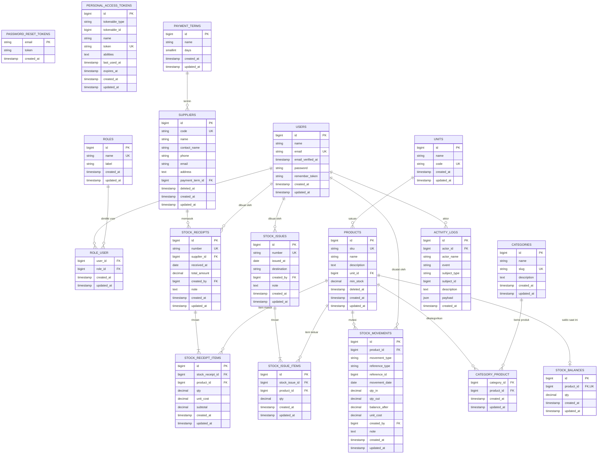

# Database — Sistem Manajemen Gudang

Dokumen ini menjadi acuan tunggal untuk schema, relasi, urutan migrasi, aturan integritas, dan strategi seeding. Semua nama tabel/kolom di sini harus sama dengan migration dan model.

## 1. Prinsip Desain

1. **Satu tabel milik satu modul.** Modul lain tidak boleh query langsung; akses lewat contract.
2. **Foreign key lintas modul tetap dibuat** untuk integritas referensial (lihat ADR-003).
3. **Saldo stok dan ledger dipisahkan:** `stock_balances` untuk saldo terkini, `stock_movements` untuk histori append-only.
4. **Dokumen stok immutable:** tidak ada edit/hapus setelah dibuat; koreksi dilakukan dengan dokumen baru (di luar MVP) atau adjustment.
5. **Soft delete** hanya untuk `products` dan `suppliers`; tabel master kecil dihapus fisik dengan pengecekan referensi.
6. **Uang dan kuantitas memakai decimal**, bukan float.
7. **Semua timestamp** memakai timezone aplikasi (`Asia/Jakarta`).

## 2. ERD



> **Catatan ERD:** `role_user` dan `category_product` adalah pivot dengan primary key komposit. `stock_movements.reference_type`/`reference_id` adalah referensi polimorfik ke dokumen stok (tanpa FK) dengan `reference_type` berupa string logis (`stock_receipt`, `stock_issue`), sehingga histori tetap ada meskipun dokumen kelak diarsipkan. `personal_access_tokens` memakai relasi polimorfik `tokenable`.

## 3. Kamus Data

### 3.1 AuthModule

#### `users`

| Kolom | Tipe | Null | Default | Aturan |
|---|---|---|---|---|
| `id` | bigint unsigned | tidak | auto increment | PK |
| `name` | varchar(100) | tidak | — | minimal 3 karakter |
| `email` | varchar(150) | tidak | — | unique, format email, lowercase |
| `email_verified_at` | timestamp | ya | null | tidak dipakai di MVP |
| `password` | varchar(255) | tidak | — | hash bcrypt/argon |
| `remember_token` | varchar(100) | ya | null | session "remember me" |
| `created_at`, `updated_at` | timestamp | ya | null | — |

#### `roles`

| Kolom | Tipe | Null | Default | Aturan |
|---|---|---|---|---|
| `id` | bigint unsigned | tidak | auto increment | PK |
| `name` | varchar(30) | tidak | — | unique; `admin`, `staff_gudang` |
| `label` | varchar(50) | tidak | — | tampilan: `Administrator`, `Staff Gudang` |
| `created_at`, `updated_at` | timestamp | ya | null | — |

#### `role_user` (pivot)

| Kolom | Tipe | Null | Default | Aturan |
|---|---|---|---|---|
| `user_id` | bigint unsigned | tidak | — | FK `users.id`, cascade on delete |
| `role_id` | bigint unsigned | tidak | — | FK `roles.id`, cascade on delete |
| `created_at`, `updated_at` | timestamp | ya | null | — |

Primary key komposit `(user_id, role_id)`; index `role_id`.

#### `password_reset_tokens`

| Kolom | Tipe | Null | Default | Aturan |
|---|---|---|---|---|
| `email` | varchar(150) | tidak | — | PK |
| `token` | varchar(255) | tidak | — | hash token |
| `created_at` | timestamp | ya | null | — |

Fitur reset password tidak wajib di UI MVP; tabel disediakan oleh Laravel/Sanctum.

#### `personal_access_tokens`

| Kolom | Tipe | Null | Default | Aturan |
|---|---|---|---|---|
| `id` | bigint unsigned | tidak | auto increment | PK |
| `tokenable_type` | varchar(255) | tidak | — | morph |
| `tokenable_id` | bigint unsigned | tidak | — | morph, index |
| `name` | varchar(255) | tidak | — | nama device/token |
| `token` | varchar(64) | tidak | — | unique, hash |
| `abilities` | text | ya | null | JSON array ability |
| `last_used_at` | timestamp | ya | null | — |
| `expires_at` | timestamp | ya | null | opsional |
| `created_at`, `updated_at` | timestamp | ya | null | — |

Index komposit `(tokenable_type, tokenable_id)`.

### 3.2 ProductModule

#### `categories`

| Kolom | Tipe | Null | Default | Aturan |
|---|---|---|---|---|
| `id` | bigint unsigned | tidak | auto increment | PK |
| `name` | varchar(100) | tidak | — | unik secara logis (case-insensitive dicek validasi) |
| `slug` | varchar(120) | tidak | — | unique |
| `description` | text | ya | null | — |
| `created_at`, `updated_at` | timestamp | ya | null | — |

#### `units`

| Kolom | Tipe | Null | Default | Aturan |
|---|---|---|---|---|
| `id` | bigint unsigned | tidak | auto increment | PK |
| `name` | varchar(50) | tidak | — | mis. `Piece`, `Box`, `Kilogram` |
| `code` | varchar(10) | tidak | — | unique, uppercase, mis. `PCS`, `BOX`, `KG` |
| `created_at`, `updated_at` | timestamp | ya | null | — |

#### `products`

| Kolom | Tipe | Null | Default | Aturan |
|---|---|---|---|---|
| `id` | bigint unsigned | tidak | auto increment | PK |
| `sku` | varchar(30) | tidak | — | unique, uppercase, pola `PRD-0001` |
| `name` | varchar(150) | tidak | — | — |
| `description` | text | ya | null | — |
| `unit_id` | bigint unsigned | tidak | — | FK `units.id`, restrict on delete |
| `min_stock` | decimal(15,3) | tidak | 0 | >= 0; ambang stok rendah |
| `deleted_at` | timestamp | ya | null | soft delete |
| `created_at`, `updated_at` | timestamp | ya | null | — |

Index `(deleted_at)`, `(name)`, `(unit_id)`.

#### `category_product` (pivot)

| Kolom | Tipe | Null | Default | Aturan |
|---|---|---|---|---|
| `category_id` | bigint unsigned | tidak | — | FK `categories.id`, cascade |
| `product_id` | bigint unsigned | tidak | — | FK `products.id`, cascade |
| `created_at`, `updated_at` | timestamp | ya | null | — |

Primary key komposit `(category_id, product_id)`; index `product_id`.

### 3.3 SupplierModule

#### `payment_terms`

| Kolom | Tipe | Null | Default | Aturan |
|---|---|---|---|---|
| `id` | bigint unsigned | tidak | auto increment | PK |
| `name` | varchar(50) | tidak | — | mis. `Cash`, `Net 7`, `Net 30` |
| `days` | unsigned smallint | tidak | 0 | 0–365 |
| `created_at`, `updated_at` | timestamp | ya | null | — |

#### `suppliers`

| Kolom | Tipe | Null | Default | Aturan |
|---|---|---|---|---|
| `id` | bigint unsigned | tidak | auto increment | PK |
| `code` | varchar(20) | tidak | — | unique, uppercase, pola `SUP-001` |
| `name` | varchar(150) | tidak | — | — |
| `contact_name` | varchar(100) | ya | null | — |
| `phone` | varchar(30) | ya | null | angka, spasi, `+`, `-` |
| `email` | varchar(150) | ya | null | format email |
| `address` | text | ya | null | — |
| `payment_term_id` | bigint unsigned | tidak | — | FK `payment_terms.id`, restrict on delete |
| `deleted_at` | timestamp | ya | null | soft delete |
| `created_at`, `updated_at` | timestamp | ya | null | — |

Index `(deleted_at)`, `(name)`, `(payment_term_id)`.

### 3.4 InventoryModule

#### `stock_receipts`

| Kolom | Tipe | Null | Default | Aturan |
|---|---|---|---|---|
| `id` | bigint unsigned | tidak | auto increment | PK |
| `number` | varchar(20) | ya | null | unique; diisi `SR-YYYYMM-000001` setelah insert |
| `supplier_id` | bigint unsigned | tidak | — | FK `suppliers.id`, restrict |
| `received_at` | date | tidak | — | tidak boleh masa depan |
| `total_amount` | decimal(15,2) | tidak | 0 | = jumlah `subtotal` item |
| `created_by` | bigint unsigned | tidak | — | FK `users.id`, restrict |
| `note` | text | ya | null | — |
| `created_at`, `updated_at` | timestamp | ya | null | — |

Index `(received_at)`, `(supplier_id)`, `(created_by)`.

#### `stock_receipt_items`

| Kolom | Tipe | Null | Default | Aturan |
|---|---|---|---|---|
| `id` | bigint unsigned | tidak | auto increment | PK |
| `stock_receipt_id` | bigint unsigned | tidak | — | FK `stock_receipts.id`, cascade |
| `product_id` | bigint unsigned | tidak | — | FK `products.id`, restrict |
| `qty` | decimal(15,3) | tidak | — | > 0 |
| `unit_cost` | decimal(15,2) | tidak | 0 | >= 0 |
| `subtotal` | decimal(15,2) | tidak | — | = qty × unit_cost |
| `created_at`, `updated_at` | timestamp | ya | null | — |

Unique `(stock_receipt_id, product_id)`; index `product_id`.

#### `stock_issues`

| Kolom | Tipe | Null | Default | Aturan |
|---|---|---|---|---|
| `id` | bigint unsigned | tidak | auto increment | PK |
| `number` | varchar(20) | ya | null | unique; `SI-YYYYMM-000001` |
| `issued_at` | date | tidak | — | tidak boleh masa depan |
| `destination` | varchar(100) | ya | null | tujuan pemakaian/pengiriman |
| `created_by` | bigint unsigned | tidak | — | FK `users.id`, restrict |
| `note` | text | ya | null | — |
| `created_at`, `updated_at` | timestamp | ya | null | — |

Index `(issued_at)`, `(created_by)`.

#### `stock_issue_items`

| Kolom | Tipe | Null | Default | Aturan |
|---|---|---|---|---|
| `id` | bigint unsigned | tidak | auto increment | PK |
| `stock_issue_id` | bigint unsigned | tidak | — | FK `stock_issues.id`, cascade |
| `product_id` | bigint unsigned | tidak | — | FK `products.id`, restrict |
| `qty` | decimal(15,3) | tidak | — | > 0 |
| `created_at`, `updated_at` | timestamp | ya | null | — |

Unique `(stock_issue_id, product_id)`; index `product_id`.

#### `stock_balances`

| Kolom | Tipe | Null | Default | Aturan |
|---|---|---|---|---|
| `id` | bigint unsigned | tidak | auto increment | PK |
| `product_id` | bigint unsigned | tidak | — | FK `products.id`, unique, restrict |
| `qty` | decimal(15,3) | tidak | 0 | >= 0 (dijaga aplikasi + transaksi) |
| `created_at`, `updated_at` | timestamp | ya | null | — |

Index `(qty)` untuk query stok rendah. Satu baris per produk; dibuat saat `ProductCreated` atau oleh seeder.

#### `stock_movements`

| Kolom | Tipe | Null | Default | Aturan |
|---|---|---|---|---|
| `id` | bigint unsigned | tidak | auto increment | PK |
| `product_id` | bigint unsigned | tidak | — | FK `products.id`, restrict |
| `movement_type` | varchar(20) | tidak | — | `receipt`, `issue`, `adjustment` |
| `reference_type` | varchar(120) | ya | null | tipe dokumen logis: `stock_receipt`, `stock_issue`, atau `adjustment` (tanpa FK) |
| `reference_id` | bigint unsigned | ya | null | ID dokumen |
| `movement_date` | date | tidak | — | tanggal efektif |
| `qty_in` | decimal(15,3) | tidak | 0 | >= 0; salah satu qty_in/qty_out > 0 |
| `qty_out` | decimal(15,3) | tidak | 0 | >= 0 |
| `balance_after` | decimal(15,3) | tidak | — | saldo setelah mutasi |
| `unit_cost` | decimal(15,2) | ya | null | untuk mutasi masuk |
| `created_by` | bigint unsigned | tidak | — | FK `users.id`, restrict |
| `note` | text | ya | null | — |
| `created_at`, `updated_at` | timestamp | ya | null | append-only; tidak ada update setelah insert |

Index `(product_id, movement_date)`, `(reference_type, reference_id)`, `(created_at)`.

### 3.5 ReportingModule

#### `activity_logs`

| Kolom | Tipe | Null | Default | Aturan |
|---|---|---|---|---|
| `id` | bigint unsigned | tidak | auto increment | PK |
| `actor_id` | bigint unsigned | ya | null | FK `users.id`, null on delete; snapshot aktor |
| `actor_name` | varchar(100) | ya | null | nama saat aksi (agar log tetap terbaca) |
| `event` | varchar(80) | tidak | — | mis. `product.created`, `stock.issued` |
| `subject_type` | varchar(120) | ya | null | string logis subjek (`product`, `supplier`, `stock_receipt`, `stock_issue`, `user`); tanpa FK lintas modul |
| `subject_id` | bigint unsigned | ya | null | ID subjek |
| `description` | text | tidak | — | kalimat manusiawi |
| `payload` | json | ya | null | data tambahan (angka, kode) |
| `created_at` | timestamp | tidak | now | tanpa `updated_at` |

Index `(event)`, `(created_at)`, `(subject_type, subject_id)`, `(actor_id)`.

**Catatan:** log tidak boleh menyimpan password, token, atau data sensitif lain.

## 4. Relasi dan Pemenuhan Ketentuan

| Relasi | Tipe | Contoh | Status |
|---|---|---|---|
| `units` → `products` | One-to-Many | satu satuan banyak produk | Wajib |
| `payment_terms` → `suppliers` | One-to-Many | satu termin banyak pemasok | Tambahan |
| `suppliers` → `stock_receipts` | One-to-Many | satu pemasok banyak penerimaan | Tambahan |
| `stock_receipts` → `stock_receipt_items` | One-to-Many | dokumen punya banyak item | Wajib untuk transaksi |
| `stock_issues` → `stock_issue_items` | One-to-Many | dokumen punya banyak item | Wajib untuk transaksi |
| `products` ↔ `categories` | Many-to-Many dengan pivot | produk punya banyak kategori | **Wajib** |
| `users` ↔ `roles` | Many-to-Many dengan pivot | user punya banyak role | **Wajib** |
| `products` → `stock_balances` | One-to-One | satu saldo per produk | Pendukung |
| `products` → `stock_movements` | One-to-Many | banyak mutasi per produk | Pendukung |

Dua relasi Many-to-Many dengan pivot (`category_product`, `role_user`) dan banyak One-to-Many memenuhi syarat minimal.

## 5. Urutan Migrasi

Gunakan prefix tanggal tetap `2026_01_01_` dan nomor urut agar urutan tidak bergantung pada urutan provider. Semua file modul berada di `app/Modules/<Modul>/Database/Migrations/`.

| Urutan | File | Modul | Bergantung pada |
|---|---|---|---|
| 1 | `0001_01_01_000000_create_cache_table.php` | root | — |
| 2 | `0001_01_01_000001_create_jobs_table.php` | root | — |
| 3 | `0001_01_01_000002_create_job_batches_table.php` | root | jobs |
| 4 | `0001_01_01_000003_create_failed_jobs_table.php` | root | — |
| 5 | `2026_01_01_000001_create_password_reset_tokens_table.php` | Auth | — |
| 6 | `2026_01_01_000002_create_users_table.php` | Auth | — |
| 7 | `2026_01_01_000003_create_roles_table.php` | Auth | — |
| 8 | `2026_01_01_000004_create_role_user_table.php` | Auth | users, roles |
| 9 | `2026_01_01_000005_create_personal_access_tokens_table.php` | Auth | users (morph, tanpa FK) |
| 10 | `2026_01_01_000100_create_categories_table.php` | Product | — |
| 11 | `2026_01_01_000101_create_units_table.php` | Product | — |
| 12 | `2026_01_01_000102_create_products_table.php` | Product | units |
| 13 | `2026_01_01_000103_create_category_product_table.php` | Product | categories, products |
| 14 | `2026_01_01_000200_create_payment_terms_table.php` | Supplier | — |
| 15 | `2026_01_01_000201_create_suppliers_table.php` | Supplier | payment_terms |
| 16 | `2026_01_01_000300_create_stock_receipts_table.php` | Inventory | suppliers, users |
| 17 | `2026_01_01_000301_create_stock_receipt_items_table.php` | Inventory | stock_receipts, products |
| 18 | `2026_01_01_000302_create_stock_issues_table.php` | Inventory | users |
| 19 | `2026_01_01_000303_create_stock_issue_items_table.php` | Inventory | stock_issues, products |
| 20 | `2026_01_01_000304_create_stock_balances_table.php` | Inventory | products |
| 21 | `2026_01_01_000305_create_stock_movements_table.php` | Inventory | products, users |
| 22 | `2026_01_01_000400_create_activity_logs_table.php` | Reporting | users |

**Langkah pemindahan migration bawaan:**
1. Setelah `php artisan install:api`, file `create_personal_access_tokens_table` yang dipublikasikan dipindahkan ke `app/Modules/Auth/Database/Migrations/` dan diganti namanya menjadi `2026_01_01_000005_...`.
2. Migration `users`, `password_reset_tokens`, dan `sessions` bawaan Laravel dipindahkan/disesuaikan: `users` dan `password_reset_tokens` ke Auth; `sessions` dihapus karena memakai driver `file`.
3. Jangan biarkan migration duplikat di `database/migrations/` dan modul.

Verifikasi:

```bash
php artisan migrate:fresh --seed
php artisan migrate:status
```

## 6. Aturan Integritas Data

### 6.1 Stok

- `qty` pada item dan movement harus **> 0**; `unit_cost` dan `min_stock` **>= 0**.
- `stock_balances.qty` tidak boleh negatif. Validasi di service **di dalam transaksi** sebelum mengurangi.
- `stock_movements.qty_in` dan `qty_out` tidak boleh keduanya > 0; untuk `receipt` isi `qty_in`, untuk `issue` isi `qty_out`.
- `balance_after` harus sama dengan saldo sebelum mutasi ± kuantitas.
- `stock_receipts.total_amount` = `SUM(stock_receipt_items.subtotal)`.
- `stock_receipts.number`/`stock_issues.number` unik; boleh null hanya sesaat di dalam transaksi.
- Satu produk hanya boleh muncul sekali per dokumen (unique composite); form memakai `distinct`.

### 6.2 Referensi lintas modul

- `products.unit_id` harus unit yang ada.
- `suppliers.payment_term_id` harus termin yang ada.
- `stock_receipts.supplier_id` harus pemasok yang ada dan **tidak soft-deleted** (divalidasi lewat contract).
- `stock_*_items.product_id` harus produk yang ada dan **tidak soft-deleted** untuk transaksi baru.
- `created_by`/`actor_id` harus user yang ada.

### 6.3 Penghapusan

| Entitas | Mekanisme | Aturan |
|---|---|---|
| Product | Soft delete | Boleh kapan saja oleh admin; riwayat tetap. Contract `find` mengembalikan null; `findIncludingDeactivated` dipakai untuk histori. |
| Supplier | Soft delete | Boleh kapan saja oleh admin; riwayat tetap. Contract `findIncludingDeactivated` dipakai untuk dokumen lama. |
| Category | Hard delete | Hanya jika tidak ada produk terkait (termasuk yang soft-deleted); jika ada → error validasi. |
| Unit | Hard delete | Hanya jika tidak ada produk terkait (termasuk soft-deleted); jika ada → error. |
| PaymentTerm | Hard delete | Hanya jika tidak ada supplier terkait (termasuk soft-deleted); jika ada → error. |
| StockReceipt/StockIssue | Tidak ada delete | Dokumen immutable; tidak ada route delete. |
| User | Tidak ada delete | Hanya via seeder/admin di luar UI; token dicabut saat logout. |

## 7. Transaksi Database

### 7.1 Penerimaan stok (`ReceiveStockService`)

```text
BEGIN
  1. Buat stock_receipts (number null sementara)
  2. Untuk setiap item (urut product_id asc):
     a. Buat stock_receipt_items
     b. Lock stock_balances WHERE product_id = ? FOR UPDATE
     c. qty_before = balance.qty
     d. qty_after = qty_before + item.qty
     e. Update balance.qty = qty_after
     f. Insert stock_movements (type=receipt, qty_in, balance_after, unit_cost)
  3. total_amount = SUM(subtotal)
  4. number = SR-YYYYMM-{id padded 6}
  5. Update receipt
COMMIT
→ dispatch StockReceived (after commit)
→ jika qty_after <= min_stock: dispatch LowStockDetected
```

### 7.2 Pengeluaran stok (`IssueStockService`)

```text
BEGIN
  1. Buat stock_issues (number null sementara)
  2. Urutkan item berdasarkan product_id asc (hindari deadlock)
  3. Untuk setiap item:
     a. Lock stock_balances WHERE product_id = ? FOR UPDATE
     b. Jika balance.qty < item.qty → throw InsufficientStockException
     c. Buat stock_issue_items
     d. Update balance.qty -= item.qty
     e. Insert stock_movements (type=issue, qty_out, balance_after)
  4. number = SI-YYYYMM-{id padded 6}
  5. Update issue
COMMIT
→ dispatch StockIssued (after commit)
→ jika saldo <= min_stock: dispatch LowStockDetected
```

### 7.3 Rollback

- Jangan menangkap exception di dalam `DB::transaction()` kecuali untuk rethrow.
- Jika satu item gagal (stok kurang, produk hilang, error DB), seluruh dokumen batal.
- Uji rollback wajib: dokumen dua item, item kedua stok kurang; pastikan tidak ada issue, item, movement, atau perubahan saldo yang tersisa.

### 7.4 Locking

- `lockForUpdate()` dipakai pada `stock_balances` agar dua transaksi tidak membaca saldo yang sama secara bersamaan.
- **SQLite:** locking baris tidak sesempurna MySQL; SQLite mengunci database saat menulis. Tetap gunakan `DB::transaction()` + `lockForUpdate()` agar kode portabel dan benar secara desain. Dokumentasikan batasan di laporan.
- Urutkan penguncian berdasarkan `product_id` menaik untuk mengurangi risiko deadlock saat pindah ke MySQL/PostgreSQL.

### 7.5 Konsistensi angka

- Gunakan `decimal` casting; bandingkan dengan `bccomp((string) $a, (string) $b, 3)`.
- Jangan memakai `==` float untuk stok.
- Format tampilan: `number_format((float) $qty, 3, ',', '.')` untuk kuantitas, 2 desimal untuk uang.

### 7.6 Rekonsiliasi (opsional, untuk laporan)

Query pemeriksaan:

```sql
-- saldo harus sama dengan total mutasi
SELECT b.product_id, b.qty,
       COALESCE(SUM(m.qty_in - m.qty_out), 0) AS ledger_qty
FROM stock_balances b
LEFT JOIN stock_movements m ON m.product_id = b.product_id
GROUP BY b.product_id, b.qty
HAVING b.qty <> COALESCE(SUM(m.qty_in - m.qty_out), 0);
```

Hasil harus kosong. Jalankan setelah seed dan setelah test.

## 8. Factory dan Seeder

### 8.1 Factory

| Factory | Model | Catatan |
|---|---|---|
| `UserFactory` | User | state `admin()`, `staff()`; password default `password` |
| `CategoryFactory` | Category | slug unik dari nama |
| `UnitFactory` | Unit | kode unik |
| `ProductFactory` | Product | SKU unik; unit acak; setelah create attach 1–2 kategori |
| `PaymentTermFactory` | PaymentTerm | days 0–30 |
| `SupplierFactory` | Supplier | kode unik; termin acak; beberapa soft-deleted untuk uji |
| `StockReceiptFactory` | StockReceipt | dipakai test; item dibuat terpisah |
| `StockReceiptItemFactory` | StockReceiptItem | qty/unit_cost acak |
| `StockIssueFactory` | StockIssue | — |
| `StockIssueItemFactory` | StockIssueItem | — |
| `StockMovementFactory` | StockMovement | untuk test query kartu stok |
| `ActivityLogFactory` | ActivityLog | untuk test dashboard/activity |

Factory tidak boleh memanggil service kompleks secara default agar test tetap deterministik; seeder inventori memakai service.

> **Batas modul di factory:** factory Inventory **tidak boleh** mengimpor model Product/Supplier/User. `StockReceiptFactory`, `StockIssueFactory`, dan `StockMovementFactory` menerima `supplier_id`/`product_id`/`created_by` dari test atau state yang diberikan. `ActivityLogFactory` memakai `actor_id` null secara default. Factory Product/Supplier hanya boleh memakai model dari modulnya sendiri.

### 8.2 Seeder

`DatabaseSeeder` memanggil berurutan:

1. `RoleSeeder` — `admin`, `staff_gudang`.
2. `UserSeeder` — 1 admin + 2 staff; assign role.
3. `ProductSeeder` — 5 kategori, 5 satuan, 20 produk; pasang kategori; buat saldo awal 0 (langsung atau dengan mengirim `ProductCreated`).
4. `SupplierSeeder` — 4 termin, 5 pemasok.
5. `InventorySeeder` — pastikan setiap produk punya baris `stock_balances` (`firstOrCreate`), lalu 3 penerimaan + 2 pengeluaran via service; saldo dan movement terbentuk, dan activity log stok ikut terisi.
6. `ReportingSeeder` (opsional) — tidak perlu jika event sudah menghasilkan log; dapat menambah log demo.

> **Penting:** `ReceiveStockService`/`IssueStockService` melakukan `lockForUpdate()` pada saldo yang sudah ada. Karena itu setiap produk wajib memiliki baris `stock_balances` sebelum transaksi pertama. Jalur normal adalah listener `CreateStockBalance` saat `ProductCreated`; seeder harus memastikan invariant ini tetap terpenuhi meskipun event tidak dijalankan.

Data contoh:

| Item | Nilai |
|---|---|
| Admin | `admin@warehouse.test` / `password` |
| Staff 1 | `staff@warehouse.test` / `password` |
| Staff 2 | `staff2@warehouse.test` / `password` |
| Kategori | Elektronik, ATK, Kebersihan, Konsumsi, Aksesori |
| Satuan | PCS, BOX, KG, L, ROLL |
| Termin | Cash (0), Net 7, Net 14, Net 30 |
| Jumlah produk | 20 |
| Jumlah pemasok | 5 |
| Penerimaan | 3 dokumen (16 item) |
| Pengeluaran | 2 dokumen (7 item) |

Pastikan seeder **tidak** menghasilkan stok negatif. Jika sebuah produk ingin didemokan stok rendah, atur `min_stock` lebih besar dari saldo setelah pengeluaran. Seeder master data sebaiknya idempotent (`firstOrCreate`/`updateOrCreate`); `InventorySeeder` boleh mengasumsikan database baru (`migrate:fresh --seed`).

## 9. Query Penting

### 9.1 Saldo dan kartu stok

```php
// Saldo satu produk
$balance = StockBalance::where('product_id', $productId)->first();

// Kartu stok dengan filter tanggal (dalam modul Inventory)
$movements = StockMovement::query()
    ->where('product_id', $productId)
    ->when($from, fn ($q) => $q->whereDate('movement_date', '>=', $from))
    ->when($to, fn ($q) => $q->whereDate('movement_date', '<=', $to))
    ->orderBy('movement_date')
    ->orderBy('id')
    ->paginate(50)
    ->withQueryString();
```

Nama produk untuk tampilan diambil lewat `ProductCatalogContract::findIncludingDeactivated($productId)`, bukan relasi lintas modul, agar produk yang sudah soft-deleted tetap tampil di riwayat.

### 9.2 Stok rendah

```php
// Di InventoryQueryService (modul Inventory).
// Service ini boleh meng-inject ProductCatalogContract (Inventory -> Product).
$snapshots = $this->products->search(limit: 1000); // ProductSnapshot[]
$balances = StockBalance::query()->get()->keyBy('product_id');

$lowStock = [];
foreach ($snapshots as $product) {
    $qty = (float) ($balances[$product->id]->qty ?? 0);
    if ($qty <= $product->minStock) {
        $lowStock[] = new LowStockView($product->id, $qty, $product->minStock);
    }
}
```

`InventoryQueryContract::lowStock()` mengembalikan hasil perhitungan ini. Reporting **tidak** membandingkan sendiri dan tidak query tabel `products`; ia hanya memakai `lowStock()` + `ProductCatalogContract::findMany()` untuk nama produk. Ini menjaga logika stok rendah tetap di Inventory.

### 9.3 Dashboard

- Total produk: `ProductCatalogContract::count()` (tambahkan method).
- Total pemasok: `SupplierDirectoryContract::count()`.
- Stok rendah: `InventoryQueryContract::lowStock()`.
- Transaksi terakhir: `InventoryQueryContract::recentMovements(5)`.
- Aktivitas terakhir: query `activity_logs` (milik Reporting).

## 10. Catatan SQLite

- Aktifkan foreign key: Laravel SQLite connector mengikuti `DB_FOREIGN_KEYS=true` (default). Cek dengan `PRAGMA foreign_keys;` → `1`.
- SQLite menyimpan `decimal` sebagai `NUMERIC`; casting Eloquent tetap diperlukan.
- `lockForUpdate()` tidak mengunci baris seperti MySQL; jangan mengandalkan uji konkurensi nyata di SQLite.
- Hindari `ALTER TABLE` kompleks; gunakan `migrate:fresh` saat pengembangan.
- File DB: `database/database.sqlite`; jangan commit.
- Backup: cukup salin file DB saat aplikasi berhenti.

## 11. Perintah Database

```bash
# Buat file SQLite
touch database/database.sqlite

# Migrasi + seed dari nol
php artisan migrate:fresh --seed

# Cek status migrasi
php artisan migrate:status

# Rollback satu batch (hati-hati)
php artisan migrate:rollback

# Seed ulang tanpa menghapus schema
php artisan db:seed

# Masuk shell SQLite
sqlite3 database/database.sqlite

# Rekonsiliasi saldo vs ledger (lihat query di atas)
```

## 12. Checklist Database

- [ ] Semua migration berada di modul yang tepat dan berurutan.
- [ ] FK lintas modul dibuat dan `migrate:fresh --seed` sukses.
- [ ] `category_product` dan `role_user` memiliki primary key komposit.
- [ ] `stock_balances.product_id` unique.
- [ ] `stock_receipts.number`/`stock_issues.number` unique.
- [ ] `stock_receipt_items`/`stock_issue_items` unique per dokumen-produk.
- [ ] Index untuk `movement_date`, `product_id`, `event`, `created_at` ada.
- [ ] Factory dan seeder menghasilkan data realistis tanpa stok negatif.
- [ ] Uji rollback membuktikan tidak ada data parsial.
- [ ] Tidak ada akses model/tabel lintas modul dari kode.
- [ ] ERD di laporan cocok dengan schema aktual.
